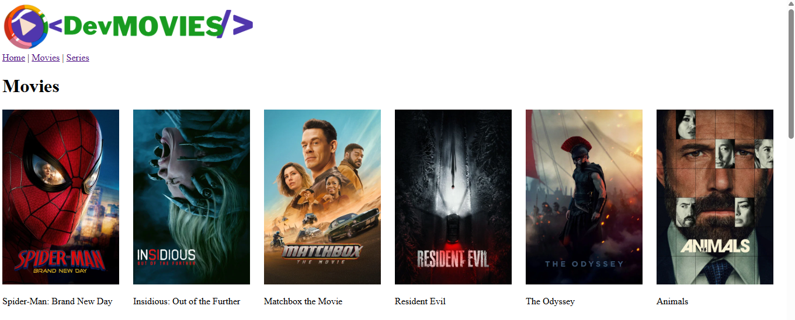

# DevMovies

A movie and TV series browser built with React and Vite, using the TMDB API.

**Live demo:** https://my-lan-movies.vercel.app



## Features

- Lists of popular movies and series
- Details page for each movie and series
- React Router for navigation
- API requests organized in a services file

## Tech

React, Vite, React Router, JavaScript, CSS. Deployed on Vercel.

## Run it locally

1. Clone the repo:
```bash
   git clone https://github.com/Oliver-Sampa/my-lan-movies.git
   cd my-lan-movies
```
2. Install dependencies:
```bash
   npm install
```
3. Get a free API key from [TMDB](https://www.themoviedb.org/settings/api) and create a `.env` file in the project root:
```
   VITE_TMDB_KEY=your_api_key_here
```
4. Start the dev server:
```bash
   npm run dev
```

## Credits

This product uses the TMDB API but is not endorsed or certified by TMDB.
